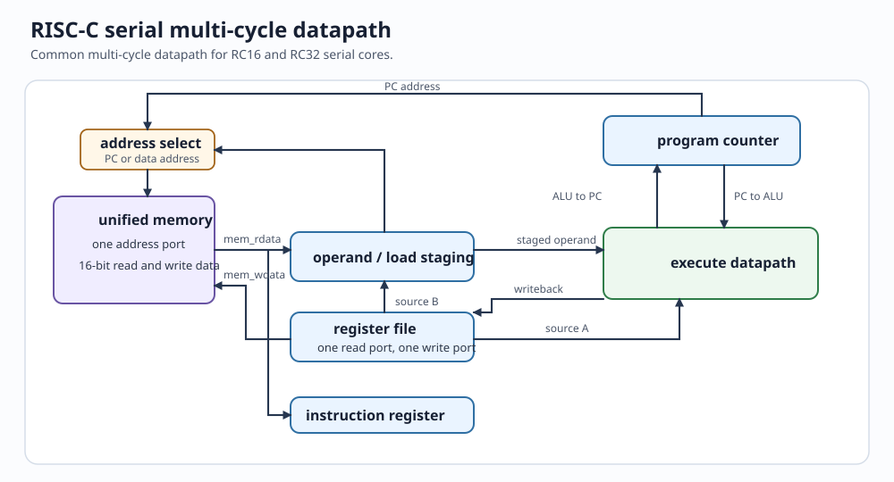
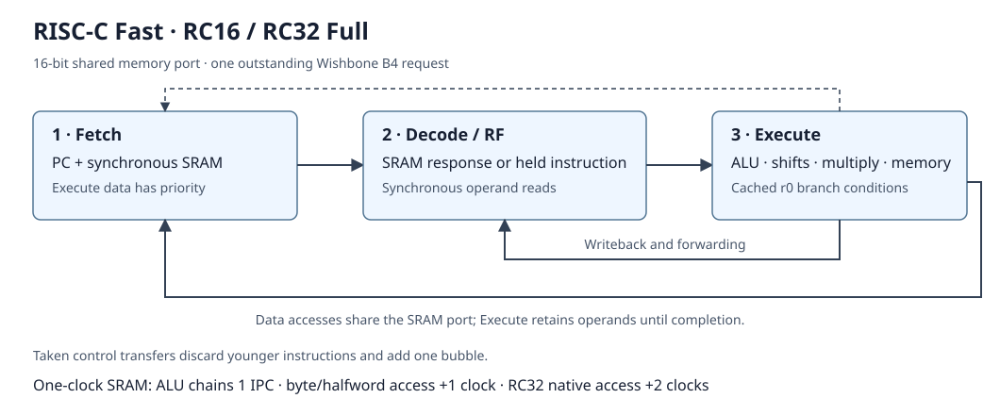
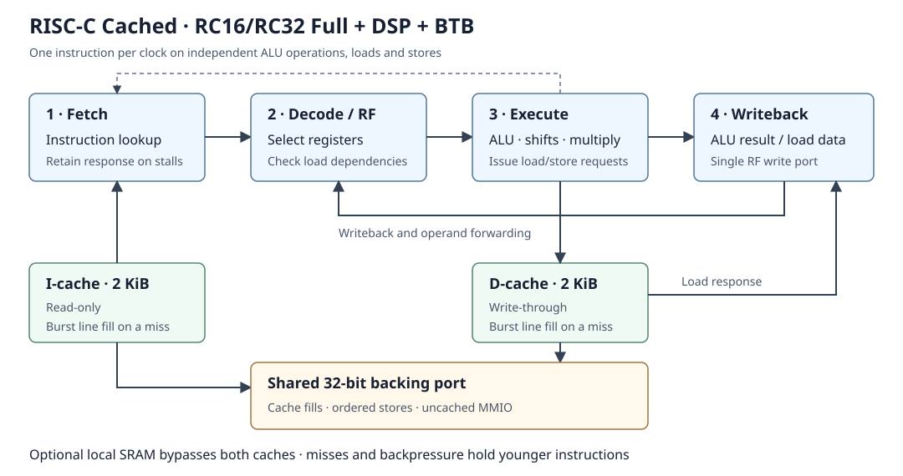
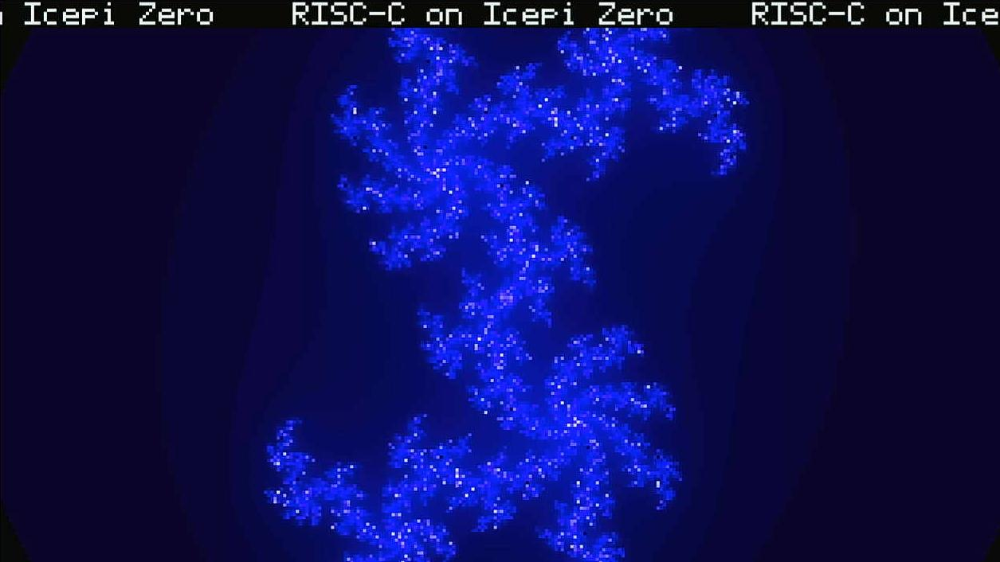
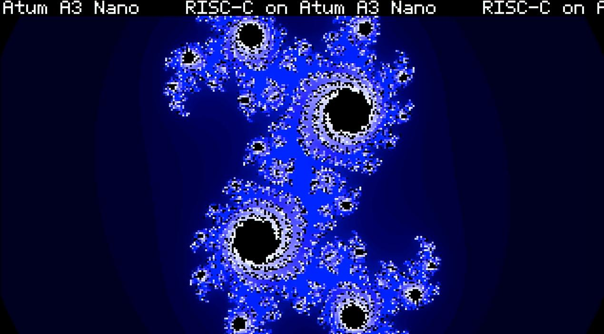

# RISC-C Hardware Manual

This manual describes the cores, memory interfaces, FPGA measurements, and
board builds. See the [ISA specification](RISC-C-ISA.md) for instructions and
the [Programming manual](PROGRAMMING.md) for software development.

## 1. Implementation family

Choose Nano or a narrow serial core for minimum area, Fast for throughput
with on-chip memory, or Cached for memory with longer access latency.
RC16 has 16-bit registers and a 64 KiB address space; RC32 has 32-bit
registers and a 4 GiB address space.

### Core families

| Implementation | Microarchitecture | RTL |
|---|---|---|
| Nano | fixed one-bit serial controller and register file | [`riscc_nano.v`](../rtl/riscc_nano.v) |
| RC16 serial `/1`–`/8` | `W`-bit sliced ALU and one-port register file; `XLEN=16` | [`riscc_serial.v`](../rtl/riscc_serial.v) |
| RC32 serial `/1`–`/16` | `W`-bit sliced ALU over a 16-bit memory port; `XLEN=32` | [`riscc_serial.v`](../rtl/riscc_serial.v) |
| RC16 `/16`, RC32 `/32` | full-width multicycle ALU; Min/Sys/Full and optional MDU | [`riscc_wide.v`](../rtl/riscc_wide.v) |
| Fast | RC16/RC32 Full, compact pipeline | [`riscc_fast.v`](../rtl/riscc_fast.v) |
| Cached | RC16/RC32 Full, DSP multiply, BTB and internal I/D caches | [`riscc_cached.v`](../rtl/riscc_cached.v) |

Compile [`riscc_pipeline_shared.v`](../rtl/riscc_pipeline_shared.v) alongside
Fast or Cached for the shifter and Fast's register file. Cached uses a
distributed register file of its own.

### External memory interfaces

Directions are relative to the core.

| Signal | Direction | Width | Cores | Meaning |
|---|---|---:|---|---|
| `mem_addr` | output | 15 or 31 | serial/wide/Fast | Halfword address; RC32 uses 31 bits, RC16 uses 15 |
| `mem_rdata` | input | 16 | serial/wide/Fast | Read data |
| `mem_wdata` | output | 16 | serial/wide/Fast | Write data |
| `mem_wmask` | output | 2 | serial/wide/Fast | Enables the low and high byte lanes |
| `mem_we` | output | 1 | serial/wide/Fast | Write direction; a one-cycle write strobe on Nano |
| `mem_valid` | output | 1 | serial/wide | Request is active |
| `mem_ready` | input | 1 | serial/wide | Completes the request; read data is valid |
| `mem_cyc` | output | 1 | Fast/Cached | Command or response pending (Wishbone CYC) |
| `mem_stb` | output | 1 | Fast/Cached | Command valid (Wishbone STB) |
| `mem_stall` | input | 1 | Fast/Cached | Target cannot accept the offered command (Wishbone STALL) |
| `mem_ack` | input | 1 | Fast/Cached | Accepted command completed; read data is valid (Wishbone ACK) |
| `mem_oe_n` | output | 1 | Nano | Active-low read enable |

On the serial and wide RC16/RC32 cores, `mem_valid` starts a transfer. The core holds
the address, direction, byte enables, and write data stable until
`mem_ready`. Only one transfer can be outstanding. Halfword accesses enable
both byte lanes; byte accesses enable the addressed lane only.

This handshake is compatible with a small subset of Wishbone B4 Classic:
`mem_addr` maps to `ADR`, `mem_rdata` and `mem_wdata` to `DAT`, `mem_wmask` to
`SEL`, `mem_we` to `WE`, `mem_valid` to both `CYC` and `STB`, and `mem_ready`
to `ACK`. A zero-wait target may tie `mem_ready` high. Bursts, pipelined
transfers, `ERR`, and `RTY` are not supported. Interface outputs are don't-care
when `mem_valid` is low.

Fast uses an ACK-only Wishbone B4 pipelined interface with one accepted request
outstanding. A command is accepted on an edge with
`mem_cyc && mem_stb && !mem_stall`. A stalled command stays stable until
accepted. ACK completes the outstanding request independently of STALL;
completion and replacement can share an edge. When no older request is
pending, ACK may complete the new command on its acceptance edge.
`mem_cyc` stays high while a command or response is pending. `ERR`, `RTY`,
and burst tags are not implemented.

Cached uses the same handshake on a 32-bit, word-addressed backing port:
`mem_addr` has `XLEN-2` bits, `mem_rdata` and `mem_wdata` are 32 bits, and
`mem_wmask` has four byte lanes.
The port carries cache-line fills, write-through stores, and uncached
accesses; instruction requests are 16 bits and data requests are 32 bits internally.

The board SRAM connects directly to the CPU instruction and data ports,
ahead of the caches. SRAM and MMIO return ACK and read data one clock after
acceptance. Writes and MMIO side effects occur at acceptance.

Nano keeps a smaller synchronous-SRAM interface. `mem_oe_n` is the active-low
read enable, and `mem_we` is a one-cycle write enable. Memory returns read data
on the next cycle and must hold it while Nano serializes the 16-bit value.
There is no acknowledge signal or wait-state support. Qualify MMIO read side
effects with `!mem_oe_n` and writes with `mem_we`; address decoding alone can
repeat an access while the address is held.

### Nano

Nano executes one instruction at a time using a one-bit ALU and register
file. It fetches and decodes the instruction, then makes 16-clock passes
over its operands, least-significant bit first. For two-register operations,
one pass saves an operand in a staging register; the execution pass combines
it with the other register's bit stream and writes the result back.

Memory instructions first calculate and retain an address, then transfer
data between the 16-bit memory port and the bit-serial register file.
Stores assemble a complete halfword before writing it. Nano requires
fixed-latency synchronous memory and has no interrupts or wait-state support.

### Serial cores

Serial cores finish one instruction before starting the next. They reuse a
narrow ALU across slices of each operand and share one memory port between
instructions and data. A single-read-port register file supplies operands
in successive passes. Smaller slices save logic but take more clocks.

After fetch and decode, a two-register operation stages one operand while
reading it from the register file. Execution then combines that saved
operand with slices of the other, carrying arithmetic state between slices
and writing the result back. Each full pass takes `XLEN/W` clocks.

Loads and stores use an address-calculation pass followed by a memory
transfer. An address register holds the request stable while memory waits;
a response register holds load data while it is copied into the register
file. Stores assemble their slices into a halfword before issuing the write.
Native RC32 accesses use two successive 16-bit transfers. Once the
instruction completes, the core advances to the next fetch.



`riscc_serial` trades throughput for area by processing `W` bits per clock.
Set `XLEN=16` or `32`, and choose a power-of-two `W` smaller than `XLEN`
(up to 16). `PROFILE=0/1/2` selects Min/Sys/Full. `RESET_PC` is a byte
address. Sys and Full support interrupts between instructions.

Use the full-width core for RC16 `/16` or RC32 `/32`.

### Parameterized full-width core

The full-width core also executes one instruction at a time, but processes
an entire register word in one ALU operation. It shares the ALU between
arithmetic, address calculation, and PC updates. Operand reads and memory
accesses still take separate cycles, keeping the hardware smaller than a
pipelined core.

Fetch retains the instruction, and decode reads the first operand. For a
two-source operation, a staging register saves that operand while the
single read port supplies the second. Execution writes the result back
before the next instruction begins. Immediate operations can skip the
second operand read.

During a load, staging holds the address while a separate scratch register
collects returned data, including both halfwords of an RC32 word. Stores
keep their source on the register-file read port until the transfer finishes.
Multiply and divide reuse the datapath over multiple cycles rather than
requiring a separate fully parallel arithmetic unit.

`riscc_wide` uses one `XLEN`-bit datapath and a synchronous register file.
`XLEN=16/32` selects the architecture; `PROFILE=0/1/2` selects Min/Sys/Full.
`RESET_PC` is a byte address. The Full profile supports three arithmetic
options on both architectures:

| Variant | Parameter | Multiply/divide instructions |
|---|---|---|
| Full | `MDU=0` | MUL |
| Full + MulH | `MDU=1` | MUL, MULHU |
| Full + MulDiv | `MDU=2` | MUL, MULHU, DIVU |

The [ISA specification](RISC-C-ISA.md#appendix-b-multiply-divide-instructions-mdu-extension)
defines the paired-register results of MULHU and DIVU.

Example full-width configurations:

```sh
make test-core PROFILE=sys WIDTH=16
make test-wide XLEN=32 PROFILE=full MDU=2 MODE=ecp5-block
```

### Pipelined core

Fast overlaps three stages, so it can fetch one instruction while decoding
another and executing a third:

| Stage | Work |
| --- | --- |
| Fetch | Request the next instruction through the shared memory port. |
| Decode / register read | Decode the instruction and read both source operands. |
| Execute | Perform the operation, access data memory if needed, and write the result back. |

Two register-file read ports supply both operands together. Forwarding makes
a completing result available to the following instruction without waiting
for another register-file read.

The memory response normally enters decode directly. A holding register
saves a fetched instruction when execution stalls. The execution stage
retains its operands until a load, store, or iterative operation completes;
then the pipeline resumes. Taken control transfers discard younger fetched
instructions and restart fetch at the target.

`riscc_fast` implements Full with `XLEN=16` or `XLEN=32` (default: 16).
Its memory port is 16 bits wide; `RESET_PC` is a halfword address.

With one-clock SRAM, simple instructions sustain one instruction per clock.
Byte and halfword loads/stores add one clock; native RC32 accesses add two.
Taken branches, jumps, and returns add one bubble. Memory stalls stop the pipeline;
interrupts wait for the current instruction to finish.

DSP multiplication takes two Execute clocks. `RISCC_FAST_SOFT_MUL` uses
fabric logic instead, taking `XLEN/2 + 1` clocks.
Signed and unsigned comparisons share the subtractor; the operand signs
adjust its borrow result for signed comparisons.



### Cached core with internal caches

[`riscc_cached`](../rtl/riscc_cached.v) combines a pipeline with separate
2 KiB, direct-mapped instruction and data caches. `XLEN=16/32` selects
RC16 or RC32 (default: 32), with 32-byte or 64-byte lines respectively.
Both use DSP multiplication and a BTB. The backing port
transfers 32-bit words. Memory-map geometry, local SRAM initialization and
reset address are the other integration parameters.
Immediate shifts by 1–8 bits complete in one Execute clock.

The pipeline has four stages: fetch reads an instruction, decode selects its
register operands, execute computes a result or issues a memory request, and writeback
updates the register file. Forwarding handles adjacent ALU dependencies.
Conditional branches consume saved `R0` flags in Execute, so an adjacent ALU
condition needs no extra branch-specific delay. An immediate load consumer,
including a branch, waits one clock before retrying in Execute. Independent
loads and stores can advance every clock on local SRAM or cache hits, provided
the backing port accepts write-through traffic. A store followed by a load of
the same cached word needs an extra RAM read clock. Accepted cache transactions
remain stable through backing-port backpressure and complete in order.

On a miss, the cache fetches a complete line and holds younger instructions.
Stores update a cached copy if present and acknowledge once their payload is
captured. The backing port completes accepted writes in order. A read miss or uncached read
waits for preceding writes to drain. Mispredicted branches discard younger
fetched instructions. DSP multiplication takes three Execute clocks and blocks
younger instructions throughout; it cannot overlap an independent ALU operation.

The data cache is write-through and does not allocate on a store miss.
`DCACHE_UNCACHED_BIT` selects uncached data and MMIO; its default, `XLEN-1`,
makes the upper half of the address space uncached. By default, instruction
fetches outside local SRAM are cached, so external executable memory must
support side-effect-free reads of complete cache lines.
`CACHE_ADDR_BITS` and `CACHE_BASE` optionally restrict caching to one aligned
region, allowing shorter tags. Other external addresses bypass the caches;
the backing port carries the full address and its `mem_cacheable` classification.
The boards cache only SDRAM.

`SRAM_ADDR_BITS` optionally places a dual-port SRAM at address zero,
bypassing both caches; 14 selects 16 KiB. `SRAM_HEX` supplies its initial
contents. Instruction and data accesses run independently on the CPU clock
and complete in one clock. Software must avoid simultaneous instruction
fetches and stores to the same SRAM word; mixed-port read/write data is
undefined. With local SRAM enabled, external instruction-cache lookups take
two clocks; data-cache hits take one. On Agilex, the 16 KiB local SRAM uses
16 M20Ks, with coherent copies serving the instruction and data ports.

The frontend uses a direct-mapped BTB with full address tags: 16 entries
on ECP5 and 32 on Agilex. Instruction fetches are 16 bits. Correctly predicted branches, JALR/RET and JALL
sustain one instruction per clock when operands and memory responses are ready.
A JALL hit skips its payload; a miss reads it and adds one clock. Taken branch
and indirect-jump misses add one clock. A predicted-taken branch that falls
through adds two clocks.

Cached implements the optional `iflush` extension; the other cores do not.
`IFLUSH` invalidates the I-cache and BTB, preserves architectural registers and
interrupt enable, and resumes at PC+2. Invalidation takes 64 clocks on RC16
or 32 on RC32, plus any wait for outstanding instruction requests. Reset performs the same invalidation.
Posted data writes continue independently; `IFLUSH` is not a store barrier.
Stores do not invalidate the I-cache automatically. Make code writes visible
using the platform's ordering rules, then execute `IFLUSH` from unmodified code
before entering the replacement, including after changing a JALL payload.
Initial loading after reset needs no maintenance if no stale instruction state
exists. See [replacing executable code](PROGRAMMING.md#replacing-executable-code).



*Default pipeline; optional local SRAM connects directly to the CPU instruction
and data ports, ahead of the caches.*

### FPGA build selection

The reference targets are ECP5 and Agilex 3. Select the profile, datapath
width, and register file with Make variables. `make help` lists the targets
and options.

```sh
make test-core PROFILE=sys WIDTH=16 MODE=native
make test-extension EXTENSION=muldiv MODE=ecp5-lutram
make trace PROFILE=min WIDTH=2
make test-fast XLEN=32 MEMORY=ecp5-block MULTIPLIER=dsp
make test-fast-irq XLEN=32
make fuzz-fast32
make bench-fast32
```

Aggregate targets such as `test-cores`, `test-extensions`, `area-lattice`, and
`fmax-lattice` iterate the profile, width, memory, and multiplier lists.

### Ideal cycles per instruction

No interrupts or memory waits; Fast/Cached assume independent instructions.
Cached uses local SRAM or cache hits, with room for write-through stores.
**—** means unsupported; ISA profile restrictions apply.

| Instruction class | Nano | Serial RC16/RC32 | Wide RC16/RC32 | Fast RC16/RC32 | Cached RC16/RC32 |
|---|---:|---:|---:|---:|---:|
| `ADD`, `SUB`, `AND`, `OR`, `XOR` | 35 | `2S + P + 2` | 3 | 1 | 1 |
| `SLT`, `SLTU` | 51 (`SLTU` only) | `3S + P + 2` | 4 | 1 | 1 |
| `LDI`, RC16 `LUI`, `ADDI`, `CMPI`, `ANDI`, `ORI`, `XORI` | 19 (no `CMPI`) | `S + P + 2` | 2 | 1 | 1 |
| Conditional branch, not taken | 19 | `S + 2` | 2 | 1 | 1 |
| Conditional branch, taken; `JMP8` | 19 | `S + 2` | 2 | 2 | 1 |
| `JALR`, `RET`, `RETI` | 35 (`JALR` only) | `2S + 2` | 3 | 2 | 1 |
| `JALL` | — | `3S + 3` | 4 | 2 | 1 |
| `MFS`, `MTS` | — | `S + P + 2` | 2 | 1 | 1 |
| `STI`, `CLI` | — | `S + 2` | 2 | 1 | 1 |
| `LD` | 52 | `3S + H + 2` | `H + 3` | `H + 1` | 1 |
| `ST` | 51 | `3S + H + 2` | `H + 3` | `H + 1` | 1 |
| `LDX` | 68 | `4S + H + 2` | `H + 4` | `H + 1` | 1 |
| `LDB`, `LDBS`, RC32 `LDH`, `LDHS` | 68 (`LDB` only) | `3S + 3` | 4 | 2 | 1 |
| `STB`, RC32 `STH` | 67 (`STB` only) | `2S + 16/W + 3` | 4 | 2 | 1 |
| RC32 `LDPC` | — | `3S + 4` | 5 | 3 | 1 |
| One-bit right shift, Min/Sys/Nano | 35 | `2S + P + 2` | 2 | — | — |
| Immediate shift by `n` bits, Full | — | `(n + 1)S + P + 2` | `2n + 1` | `n` | 1 |
| `FSR1` | — | `3S + P + 2` | 3 | 1 | 1 |
| `FSL1` | — | `3S + P + 2` | 4; 3 with MulDiv | 1 | 1 |
| Fabric `MUL` | — | `(L + 2)S + P + 2` | `L + 3` | `L/2 + 1` | — |
| DSP `MUL` | — | — | — | 2 | 3 |
| `MULHU`, MulH/MulDiv | — | — | `L + 4` | — | — |
| `DIVU`, MulDiv | — | — | `3L + 3` | — | — |

`L = XLEN`, `W` = serial datapath width, `S = L/W`, `H = L/16`, `n = 1–8`.
`P = S` for RC16 Min/Sys `/8` and RC32 `/8` or `/16`; otherwise `P = 0`.

Cached control-transfer figures assume correct predictions. A taken/indirect
miss or cold JALL adds one clock; a predicted-taken branch that falls through
adds two. With local SRAM enabled, instruction-cache fetches take at least 2 CPI even
on hits. Cached adds one cycle for an immediate load consumer or a store
followed by a load of the same cached word; these penalties can combine.

## 2. Measurements

### Measurement conditions

Area includes the core and register file; it excludes program/data memory,
peripherals, and board logic. `/W` is the datapath width in bits. RC16 `/16`
and RC32 `/32` use `riscc_wide`; smaller widths use `riscc_serial`. MulH and
MulDiv are Full-profile options available only at full width. A dash marks
an unsupported configuration.

ECP5 results target the LFE5U-25F, speed grade 6. Area is the minimum LUT4
site count across usable mapping recipes. Clock rates are medians over routing
seeds 1–32, or 1–128 for Nano. Serial and wide cores use the minimum block-RF
area, with ties resolved by median Fmax. Fast uses the recipe with
the highest median MIPS per LUT4 site. Efficiency uses the area of that
timed recipe. Cached ECP5 results use Yosys 0.33 and nextpnr-ecp5 0.6-3build5
at seed 1, with the timed recipe chosen for MIPS per LUT4 site.

Agilex 3 results use Quartus Pro 26.1, seed 1, and a 4 ns target. The recipe
is Aggressive Area for Full, MulH, and MulDiv, and High Performance Effort
for other profiles. Area is Quartus's **ALMs needed** for the core and MLAB
register file, accounting for estimated dense packing. Fmax is the post-fit
restricted-Fmax estimate; it does not guarantee timing closure at that clock. One ALM counts as
2.95 LEs for efficiency.

Core-only measurements exclude board initialization and are not programmable
board images. Cached tables use DSP multiplication and the target-specific BTB sizes above.

### Area

| ECP5 LUT4 sites (+ 1 RF EBR) | /1 | /2 | /4 | /8 | /16 | /32 |
|---|---:|---:|---:|---:|---:|---:|
| RC16 Min | 123 | 137 | 169 | 193 | 232 | — |
| RC16 Sys | 145 | 155 | 187 | 221 | 253 | — |
| RC16 Full | 175 | 188 | 228 | 297 | 313 | — |
| RC16 Full + MulH | — | — | — | — | 323 | — |
| RC16 Full + MulDiv | — | — | — | — | 357 | — |
| RC32 Min | 147 | 161 | 184 | 217 | 299 | 382 |
| RC32 Sys | 172 | 181 | 212 | 250 | 335 | 410 |
| RC32 Full | 203 | 220 | 259 | 303 | 430 | 508 |
| RC32 Full + MulH | — | — | — | — | — | 518 |
| RC32 Full + MulDiv | — | — | — | — | — | 569 |

| ECP5 LUT4 sites (LUTRAM RF included) | /1 | /2 | /4 | /8 | /16 | /32 |
|---|---:|---:|---:|---:|---:|---:|
| RC16 Min | 165 | 179 | 206 | 225 | 256 | — |
| RC16 Sys | 187 | 198 | 223 | 255 | 277 | — |
| RC16 Full | 218 | 229 | 264 | 330 | 337 | — |
| RC16 Full + MulH | — | — | — | — | 347 | — |
| RC16 Full + MulDiv | — | — | — | — | 381 | — |
| RC32 Min | 233 | 244 | 260 | 284 | 364 | 430 |
| RC32 Sys | 256 | 265 | 289 | 319 | 401 | 458 |
| RC32 Full | 289 | 305 | 335 | 372 | 496 | 556 |
| RC32 Full + MulH | — | — | — | — | — | 566 |
| RC32 Full + MulDiv | — | — | — | — | — | 617 |

| Agilex 3 ALMs (MLAB RF included) | /1 | /2 | /4 | /8 | /16 | /32 |
|---|---:|---:|---:|---:|---:|---:|
| RC16 Min | 96.4 | 111.0 | 113.3 | 122.0 | 121.8 | — |
| RC16 Sys | 112.6 | 117.8 | 121.7 | 130.2 | 150.3 | — |
| RC16 Full | 107.4 | 115.0 | 123.0 | 143.3 | 153.8 | — |
| RC16 Full + MulH | — | — | — | — | 169.1 | — |
| RC16 Full + MulDiv | — | — | — | — | 178.5 | — |
| RC32 Min | 121.3 | 136.3 | 135.0 | 144.0 | 190.1 | 222.6 |
| RC32 Sys | 130.1 | 143.0 | 150.5 | 159.8 | 219.1 | 237.5 |
| RC32 Full | 130.5 | 143.4 | 150.1 | 171.5 | 223.7 | 251.2 |
| RC32 Full + MulH | — | — | — | — | — | 253.4 |
| RC32 Full + MulDiv | — | — | — | — | — | 261.8 |

| Nano, Fast, and Cached area | ECP5 block-RF LUT4 sites | ECP5 LUTRAM-RF sites | ECP5 timed sites | Agilex 3 ALMs needed, RF included |
|---|---:|---:|---:|---:|
| Nano | 94 | 115 | 94 | 78.9 |
| RC16 Fast DSP | 499 | 546 | 499 | 260.7 |
| RC16 Fast soft | 557 | 591 | 572 | 253.4 |
| RC32 Fast DSP | 880 | 958 | 880 | 423.7 |
| RC32 Fast soft | 949 | 1043 | 953 | 437.8 |
| RC16 Cached DSP | — | 1242 | 1242 | 578.8 |
| RC32 Cached DSP | — | 1958 | 2040 | 888.7 |

ECP5 Nano uses one RF EBR. ECP5 Fast DSP uses one DSP block at XLEN=16 and
three at XLEN=32; Agilex uses one and two. Cached uses the same DSP counts.
The LUTRAM column includes the complete register file. Cached includes both
2 KiB caches, their tags, and the register file. Cache data uses two memory
blocks; tags and valid bits use LUTRAM on ECP5 and MLABs on Agilex.
Cached's RF also uses LUTRAM/MLABs. Timed ECP5 results use the block RF for
Nano and Fast, and LUTRAM for Cached.
Fast ECP5 timing uses the median over seeds 1–32; Cached uses seed 1.

The ECP5 area columns use the recorded mapping recipes. The timed-recipe
area column is used for Fmax and efficiency comparisons. Cached's minimum-area
recipes are `-dff` for RC16 and the default for RC32; its timed recipes
are `-dff` and `-abc9`, respectively. Native RC32 Sys/Full and arithmetic
extensions use a minimum block-area recipe for timing.

### Clock rate

| ECP5 Fmax (MHz, EBR RF) | /1 | /2 | /4 | /8 | /16 | /32 |
|---|---:|---:|---:|---:|---:|---:|
| RC16 Min | 88.16 | 79.58 | 72.38 | 69.91 | 74.73 | — |
| RC16 Sys | 82.78 | 80.24 | 75.44 | 71.01 | 74.28 | — |
| RC16 Full | 78.40 | 78.12 | 71.70 | 68.17 | 74.52 | — |
| RC16 Full + MulH | — | — | — | — | 73.79 | — |
| RC16 Full + MulDiv | — | — | — | — | 72.25 | — |
| RC32 Min | 86.84 | 79.40 | 70.17 | 64.01 | 65.92 | 68.40 |
| RC32 Sys | 80.38 | 78.63 | 73.97 | 63.00 | 65.89 | 71.35 |
| RC32 Full | 75.64 | 81.16 | 71.47 | 63.83 | 67.99 | 72.37 |
| RC32 Full + MulH | — | — | — | — | — | 73.19 |
| RC32 Full + MulDiv | — | — | — | — | — | 71.35 |

| Agilex 3 Fmax (MHz, MLAB RF) | /1 | /2 | /4 | /8 | /16 | /32 |
|---|---:|---:|---:|---:|---:|---:|
| RC16 Min | 314.47 | 301.30 | 266.88 | 270.86 | 273.75 | — |
| RC16 Sys | 318.07 | 308.17 | 282.33 | 273.37 | 260.96 | — |
| RC16 Full | 290.44 | 279.49 | 265.04 | 262.33 | 223.61 | — |
| RC16 Full + MulH | — | — | — | — | 245.28 | — |
| RC16 Full + MulDiv | — | — | — | — | 242.31 | — |
| RC32 Min | 301.66 | 283.53 | 268.46 | 261.78 | 238.04 | 239.06 |
| RC32 Sys | 295.07 | 287.85 | 273.30 | 267.17 | 253.23 | 247.89 |
| RC32 Full | 267.31 | 291.63 | 267.45 | 243.96 | 217.49 | 213.77 |
| RC32 Full + MulH | — | — | — | — | — | 205.80 |
| RC32 Full + MulDiv | — | — | — | — | — | 218.25 |

| Other implementation Fmax (MHz) | ECP5, timed RF | Agilex 3, MLAB RF |
|---|---:|---:|
| Nano | 87.11 | 291.80 |
| RC16 Fast DSP | 60.60 | 239.12 |
| RC16 Fast soft | 58.09 | 250.00 |
| RC32 Fast DSP | 53.72 | 218.10 |
| RC32 Fast soft | 55.91 | 239.87 |
| RC16 Cached DSP | 69.57 | 231.43 |
| RC32 Cached DSP | 69.69 | 207.94 |

Fast ECP5 Fmax values are medians over seeds 1–32; Cached uses seed 1.


### RC16 benchmark throughput

Both widths run byte copy, strlen, strcmp, CRC16, 32-bit arithmetic, software
division, bubble sort, and FIR, with matching inputs and loop counts.
`test_riscc_bench` retires 3238 instructions. Nano runs a software-multiply
version with 8491 instructions. MIPS uses each version's instruction count;
compare elapsed time when judging the same workload across those versions.
The benchmark uses MUL but does not exercise MULHU or DIVU.
Fast benchmarks use registered one-clock SRAM responses in Verilator; Cached
uses one-clock native 32-bit SRAM and includes cold-cache initialization and
misses; serial/wide benchmarks use the ready-memory fixture.

Throughput combines the clock rates above with the Verilator cycle counts
below. ECP5 uses the block RF except for Cached's LUTRAM RF.
Cached cycle counts differ between targets because their BTB sizes differ;
other cores have the same cycle counts on both targets.

| Core | ECP5 MIPS | Agilex MIPS | ECP5 MIPS/kLUT4 | Agilex MIPS/kLE |
|---|---:|---:|---:|---:|
| RC16 Full /1 | 2.29 | 8.47 | 13.1 | 26.7 |
| RC16 Full /2 | 4.28 | 15.33 | 22.8 | 45.2 |
| RC16 Full /4 | 7.03 | 25.98 | 30.8 | 71.6 |
| RC16 Full /8 | 11.02 | 42.41 | 37.1 | 100.3 |
| RC16 Full /16 | 24.76 | 74.29 | 79.1 | 163.7 |
| RC16 Full + MulH /16 | 24.52 | 81.49 | 75.9 | 163.4 |
| RC16 Full + MulDiv /16 | 24.00 | 80.50 | 67.2 | 152.9 |
| Nano | 2.80 | 9.40 | 29.8 | 40.4 |
| RC16 Fast DSP | 45.32 | 178.86 | 90.8 | 232.6 |
| RC16 Fast soft | 39.38 | 169.46 | 68.8 | 226.7 |
| RC16 Cached DSP | 53.96 | 180.09 | 43.4 | 105.5 |

| Core | Cycles |
|---|---:|
| RC16 Full /1 | 111084 |
| RC16 Full /2 | 59052 |
| RC16 Full /4 | 33036 |
| RC16 Full /8 | 20028 |
| RC16 Full /16 | 9746 |
| RC16 Full + MulH /16 | 9746 |
| RC16 Full + MulDiv /16 | 9746 |
| Nano | 263691 |
| RC16 Fast DSP | 4329 |
| RC16 Fast soft | 4777 |
| RC16 Cached DSP | 4175 / 4161 |


### RC32 benchmark throughput

`test_rc32_bench` runs the same eight kernels as RC16 and retires 3123
instructions. Sort and FIR use native 32-bit words; the 32-bit arithmetic
kernel needs fewer instructions than RC16's register pairs. Compare cycle
counts and elapsed time for workload performance; MIPS also reflects these
instruction-count differences. Memory fixtures match those described above.

| Core | Cycles | ECP5 MIPS | Agilex MIPS | ECP5 MIPS/kLUT4 | Agilex MIPS/kLE |
|---|---:|---:|---:|---:|---:|
| RC32 Full /1 | 248336 | 0.95 | 3.36 | 4.7 | 8.7 |
| RC32 Full /2 | 127864 | 1.98 | 7.12 | 9.0 | 16.8 |
| RC32 Full /4 | 67628 | 3.30 | 12.35 | 12.7 | 27.9 |
| RC32 Full /8 | 44978 | 4.43 | 16.94 | 14.6 | 33.5 |
| RC32 Full /16 | 26185 | 8.11 | 25.94 | 18.9 | 39.3 |
| RC32 Full /32 | 11191 | 20.20 | 59.66 | 39.8 | 80.5 |
| RC32 Fast soft | 5775 | 30.23 | 129.72 | 31.7 | 100.4 |
| RC32 Fast DSP | 4815 | 34.84 | 141.46 | 39.6 | 113.2 |
| RC32 Cached DSP | 4197 / 4195 | 51.86 | 154.80 | 25.4 | 59.0 |

Cached cycle pairs list ECP5 / Agilex.

With direct SRAM and speed-optimized libraries, RC32 Cached measures
1.407 DMIPS/MHz with 32 BTB entries and 1.391 with 16 entries. These are RTL
simulation results; the measured Dhrystone loops take 404,529 and 409,022
cycles respectively.

### Software floating point

The RC32 Full compiler benchmarks below use `-Os` for both the application
and runtime, without LTO. They run on the pipeline with direct, one-clock
SRAM responses and no caches. Cycles cover the complete program through its
result write; image sizes include startup, constants and required libraries,
but exclude `.bss`.

| Workload (`test/compiler/bench/`) | Image bytes | RTL cycles |
|---|---:|---:|
| `libm32.c`: math functions | 4,436 | 8,275 |
| `softfloat.c`: arithmetic and math loop | 3,372 | 120,758 |

Size-built floating-point helpers enable private-literal sharing; see
[runtime optimization](PROGRAMMING.md#libraries).

### CoreMark

The RC32 Full port uses the unchanged CoreMark workload at revision
`1f483d5b8316753a742cbf5590caf5bd0a4e4777`, a single context and the standard
2,000-byte static dataset. Both seed sets pass the upstream CRC/type checks
in RTL simulation at `-O2`, `-O3` and `-Os`. The application and runtime use
the same optimization settings, hardware multiplication and software division.

The table below uses short, non-LTO, 100-iteration performance-seed runs for
compiler and memory-system comparisons. These runs do not meet CoreMark's
ten-second target-duration requirement. Timing comes from a coherent 64-bit cycle counter
in the RTL fixture, excluding initialization and reporting.

| RC32 pipeline configuration | `-O2` cycles/iteration | `-O3` cycles/iteration | `-Os` cycles/iteration |
|---|---:|---:|---:|
| Direct SRAM, no caches | 363,543.50 | 358,875.60 | 481,143.59 |
| 2 KiB I-cache + 2 KiB D-cache | 377,381.74 | 392,020.21 | 504,157.55 |

Separate 4,000-iteration direct-SRAM runs measure ordinary `-O3` and the
[tuned `-O3` recipe](PROGRAMMING.md#coremark). The application and runtime
use the same flags in each build.

| Build | Timed performance cycles | CoreMark/MHz | Performance image bytes |
|---|---:|---:|---:|
| Ordinary `-O3` | 1,435,481,305 | 2.7865 | 10,940 |
| `-O3` with five optional LLVM tuning flags | 1,338,611,552 | 2.9882 | 11,836 |

Both builds pass the upstream CRC checks with performance and validation
seeds. All four runs exceed ten simulated seconds at 100 MHz; these are RTL
simulation results, not measurements on a fitted FPGA. The optional tuning
increases inlining, enables loop flattening, reverses local register assignment,
removes global-copy priority during coalescing and raises the tail-duplication
limit to eight instructions. It does not change compiler defaults.

Both memory configurations use native-width, one-clock SRAM responses, a 16-entry
BTB and the ECP5 synchronous register-file implementation. The direct fixture
has separate instruction/data ports; the cached fixture uses the shared
backing-memory port. These are simulation configurations, not fitted FPGA designs.

The short performance-run ROM images are 10,620 bytes (`-O2`), 10,940 bytes
(`-O3`) and 8,504 bytes (`-Os`), including startup, reporting, constants and
required runtime helpers, excluding `.bss`. Reproduce with
`make -j16 COREMARK_OPT=-O3 coremark` (or `-O2`/`-Os`); see
[CoreMark usage and timing](PROGRAMMING.md#coremark).

Application-only LTO with the ordinary `-Os` runtime reduces the performance
image to 7,780 bytes and direct-SRAM time to 457,874.88 cycles/iteration.
The same image takes 493,673.51 cycles/iteration through the caches.
Both seed sets pass in SRAM and cached RTL simulation.

### Comparison with other cores

#### Benchmark binary size: common compiler and sources

Each benchmark uses the same project LLVM/Clang and LLD 23.1.0 source revision
across the RISC-C, ARM and RISC-V backends: `495b2e6a08b6`.
All builds use hardware multiplication, software
division, and common benchmark and C library sources.
CoreMark uses full LTO across its application translation units on every
architecture; startup and runtime libraries remain separately compiled.
Dhrystone uses separate compilation without LTO. Applications and C libraries
use the indicated optimization level; unused sections are discarded by the linker. Sizes are
flat binary image bytes, including startup, constants, reporting, required runtime helpers and
alignment padding, excluding ELF metadata and zero-initialized RAM (`.bss`).
RISC-C builds use the compiler and linker optimizations described in
[Programming](PROGRAMMING.md).

| ISA | Dhrystone `-O2` | Dhrystone `-Os` | CoreMark `-O2 -flto` | CoreMark `-Os -flto` |
|---|---:|---:|---:|---:|
| RISC-C, RC32 | 2,009 | 1,764 | 10,576 | 7,508 |
| RISC-V, RV32IC+Zmmul | 2,260 | 2,196 | 11,072 | 8,124 |
| Arm Thumb-2 | 2,435 | 1,943 | 24,592–24,640 | 7,460–7,476 |

Including the C runtime in RC32 `-Os` LTO produces 7,480 bytes, versus 7,508
with application-only LTO. Validation-seed images are eight bytes larger in
both cases. Both seed sets pass ISS and SRAM/cached RTL checks.
The table uses application-only LTO consistently across architectures.

Dhrystone uses separate translation units with procedure inlining disabled.
CoreMark uses its unchanged upstream sources and the common project port,
with normal inlining, the 2,000-byte dataset and 100 performance-seed iterations.
Its compiler-flags description string is identical across targets; the normal
RC32 build above embeds the full command line and is correspondingly larger.
For RC32 `-Os -flto`, these are 7,508 and 7,780 bytes respectively; the
272-byte difference is read-only reporting data, not additional instructions.

RISC-V uses `-march=rv32ic_zmmul -mabi=ilp32`: compressed instructions and
hardware multiplication, without hardware division. Its software division
uses the generic compiler-rt C helpers. RC32 uses its assembly runtime.
Arm uses `-mcpu=cortex-m3` or `-mcpu=cortex-m4`, with
`-mthumb -mfloat-abi=soft -mhwdiv=none` and the same compiler-rt division helpers.
The CoreMark size ranges cover these two compiler targets. Both targets
produce identical Dhrystone images.
Their four Dhrystone builds pass 1,000 iterations and final-state checks in Unicorn 2.1.4's
instruction-set simulator, each executing 1,000 software-division calls.
The CoreMark images pass upstream CRC checks in the RISC-C ISS or Unicorn
(RISC-V and Arm); none contains hardware divide instructions. Unicorn does
not model clock cycles, so it validates execution, not throughput.

To enable the comparison backends in the existing compiler build:

```sh
cmake -S external/llvm-project/llvm -B build/llvm-riscc \
  '-DLLVM_TARGETS_TO_BUILD=ARM;RISCV' -DLLVM_EXPERIMENTAL_TARGETS_TO_BUILD=RISCC
CCACHE_DIR="$PWD/build/ccache" cmake --build build/llvm-riscc \
  --target clang lld --parallel 16
```

#### Benchmark performance: core-specific builds

These are core-reported Dhrystone 2.1 and CoreMark scores, plus the project's
RTL measurements, not timings of the common size-comparison binaries.
Compiler, runtime, memory system and division support differ between results.

| Architecture | Core | DMIPS/MHz | CoreMark/MHz | Source |
|---|---|---:|---:|---|
| RISC-C | RC32 pipeline, direct SRAM | 1.407 | 2.7865 / 2.9882† | [Dhrystone RTL](#rc32-benchmark-throughput), [CoreMark RTL](#coremark) |
| RISC-V | VexRiscv full max perf, dynamic prediction, 8 KiB I-cache + 8 KiB D-cache | 1.38 | 2.57 | [VexRiscv configuration results](https://github.com/SpinalHDL/VexRiscv#area-usage-and-maximal-frequency) |
| RISC-V | VexRiscv full, no caches, static prediction | 1.21 | 2.30 | [VexRiscv configuration results](https://github.com/SpinalHDL/VexRiscv#area-usage-and-maximal-frequency) |
| RISC-V | PicoRV32, normal / look-ahead memory | 0.305 / 0.516 | — | [PicoRV32 documentation](https://github.com/YosysHQ/picorv32#cycles-per-instruction-performance) |
| Arm Thumb-2 | Cortex-M3 | 1.25 | 3.45 | [Arm Dhrystone](https://community.arm.com/cfs-file/__key/telligent-evolution-components-attachments/01-2057-00-00-00-01-28-35/Cortex_2D00_M-for-Beginners-_2D00_-2017_5F00_EN_5F00_v2.pdf#page=20), [Arm CoreMark](https://documentation-service.arm.com/static/655e085f2c8b3557fee7048f) |
| Arm Thumb-2 | Cortex-M4 | 1.25 | 3.54 | [Arm Dhrystone](https://community.arm.com/cfs-file/__key/telligent-evolution-components-attachments/01-2057-00-00-00-01-28-35/Cortex_2D00_M-for-Beginners-_2D00_-2017_5F00_EN_5F00_v2.pdf#page=20), [Arm CoreMark](https://documentation-service.arm.com/static/655e085f2c8b3557fee7048f) |

† RC32 CoreMark: ordinary `-O3` / `-O3` with five optional LLVM tuning flags.
Throughput is RTL-derived, calculated as `1000000 / cycles_per_iteration`;
the duration and validation conditions are listed above.
`—` means no score is quoted for that configuration. VexRiscv's
2.57 score belongs to `full max perf` (1.38 DMIPS/MHz); 2.30 belongs to
`full no cache` (1.21 DMIPS/MHz). Its separate 1.44 DMIPS/MHz headline does not
have a corresponding CoreMark score listed. Arm's CoreMark figures are from
its 2023 processor comparison table.

RC32 uses software division and direct SRAM. Dhrystone uses `-O2` and a
32-entry BTB; both CoreMark builds use the ECP5
16-entry BTB. Dhrystone timing covers 1,000
iterations between the benchmark's markers, excluding setup and final-state
verification: 404,529 loop cycles. DMIPS/MHz is
`iterations * 1000000 / (1757 * loop_cycles)`.

VexRiscv's `full max perf` configuration uses RV32IM with hardware division,
8 KiB instruction and data caches, fetch-stage dynamic branch prediction,
and execute-stage branch and shift operations.
PicoRV32's published scores enable fast multiplication, hardware division and
a barrel shifter. Its
[look-ahead interface](https://github.com/YosysHQ/picorv32#look-ahead-interface)
provides the next memory address and controls one cycle before `mem_valid`,
allowing synchronous SRAM to start the access earlier; these combinational
outputs can make timing closure harder. Arm's 1.25 figures are its official
scores without procedure inlining or multi-file compilation, not its higher
full-optimization figures.

#### FPGA size and clock comparison

This table compares compact and pipelined RISC-C and RISC-V cores using recorded RISC-C
fits and upstream-published RISC-V results. They are not same-device,
same-tool measurements. Counts retain their device-native units; neither
count represents the additional embedded RAM and DSP blocks used by a core.
`—` means no matching measurement is available, not that the core is unsupported.

| Core | Configuration | FPGA | Logic area | Fmax (MHz) | Source |
|---|---|---|---:|---:|---|
| RISC-C RC16 Nano (with RF) | 16-bit architecture, one-bit serial datapath, MLAB RF | Agilex 3 | 78.9 ALMs | 291.80 | [RISC-C measurement conditions](#measurement-conditions) |
| RISC-C RC32 Min /1 (with RF) | 32-bit architecture, one-bit serial datapath, Min profile, MLAB RF | Agilex 3 | 121.3 ALMs | 301.66 | [RISC-C measurement conditions](#measurement-conditions) |
| RISC-C RC32 Cached (with RF) | 2 KiB I-cache + 2 KiB D-cache, 32-entry BTB, DSP multiply | Agilex 3 | 888.7 ALMs | 207.94 | [RISC-C measurement conditions](#measurement-conditions) |
| RISC-V SERV minimal | Minimum-area bit-serial configuration, excluding RF | Artix-7 | 125 LUTs | — | [SERV datasheet, Area](https://serv.readthedocs.io/en/stable/datasheet.html#area) |
| RISC-V VexRiscv full | RV32IM, 4 KiB I-cache + 4 KiB D-cache, static prediction | Cyclone V | 1,166 ALMs | 141 | [VexRiscv area and Fmax](https://github.com/SpinalHDL/VexRiscv#area-usage-and-maximal-frequency) |
| RISC-V VexRiscv full | RV32IM, 4 KiB I-cache + 4 KiB D-cache, static prediction | Artix-7 | 1,840 LUTs | 199 | [VexRiscv area and Fmax](https://github.com/SpinalHDL/VexRiscv#area-usage-and-maximal-frequency) |
| RISC-V PicoRV32 large | RV32IMC, PCPI, IRQ, multiply/divide and barrel shifter | Kintex-7 | 2,019 LUTs | — | [PicoRV32 utilization](https://github.com/YosysHQ/picorv32#utilization-on-xilinx-7-series-fpgas) |

An [Agilex 3 ALM](https://docs.altera.com/r/docs/817231/current/agilextm-3-fpgas-and-socs-device-overview/adaptive-logic-module-in-agilextm-3-fpgas-and-socs)
has an eight-input fracturable LUT structure; a
[7-series LUT](https://docs.amd.com/r/en-US/ug474_7Series_CLB/Look-Up-Table)
has six inputs and can split into two five-input functions with shared inputs.
There is no workload-independent conversion between their counts. ECP5 and
iCE40 LUT4 counts would be useful for a same-family comparison, but changing
the unit alone does not normalize different memory, carry and packing resources.

All RISC-C area figures include their MLAB register files (RF). The RISC-C
rows use Quartus Pro 26.1, device `A3CZ135BB18AE7S`, seed 1 and the
post-fit restricted-Fmax estimate. Nano and Min `/1` include their MLAB register
files, with no block RAM or DSP blocks. Cached's ALM count includes the MLAB register
file and cache metadata; Cached also uses two M20Ks, with Quartus estimating
two DSP blocks needed after dense packing.
The source snapshot for this fit matches the current RTL. VexRiscv reports
its fastest Cyclone V speed grade with neutral synthesis options and an
aggressive clock constraint; those conditions differ from the Agilex fit.

SERV reports 125 LUTs and 164 flip-flops for its most minimal Artix-7
synthesis, explicitly excluding the register file. Its datasheet gives no
matching Fmax, so the table does not infer one from another configuration.

The VexRiscv PPA rows use its published `full` configuration with 4 KiB caches
and static prediction, not the `full max perf` configuration scoring
2.57 CoreMark/MHz. PicoRV32's LUT figure
is its Vivado 2017.3 area-optimized `large` result, including 88 memory LUTs.
Its published timing configuration is not comparable and is omitted here.
RISC-C has no recorded Xilinx 7-series fit or routed Fmax, and PicoRV32's
upstream documentation gives no Intel ALM/Fmax pair.

### Reproducing measurements

```sh
make -j16 tables-lattice
make -j16 QUARTUS_SH=/path/to/quartus/bin/quartus_sh tables
```

`tables-lattice` evaluates mapping recipes at routing seed 1 by default and
runs the common RTL benchmark. Set `TUNE_SEEDS=32` for a 32-seed sweep.
Recipe choices and raw results are written under `build/tune/`.

To reproduce only the recorded Cached ECP5 area and timing recipes:

```sh
make -j6 PNR_SEED=1 \
  build/area/ecp5-lutram/cached/dsp.resources \
  build/area/ecp5-lutram/cached32/dsp.resources \
  build/area/ecp5-block/cached/dsp.resources \
  build/area/ecp5-block/cached32/dsp.resources \
  build/fmax/ecp5/cached/dsp.mhz build/fmax/ecp5/cached32/dsp.mhz
```

For Cached, the `ecp5-lutram` area targets use the minimum-area recipes, while
`ecp5-block` uses the timed recipes. Both include the fixed LUTRAM register file.

For one full-width configuration:

```sh
python3 tools/lattice_tune.py ecp5 wide32-muldiv --seeds 32 -j 16
```

Use `--resume` to continue an interrupted sweep.

## 3. FPGA toolchain

The open-source flow needs yosys, Verilator 5 or newer, g++, Python 3,
nextpnr-ecp5, prjtrellis, and optionally ccache and openFPGALoader. On
Debian/Ubuntu:

```sh
sudo apt-get install -y build-essential make python3 ccache libsdl2-dev libstb-dev \
  verilator yosys nextpnr-ecp5 fpga-trellis \
  openfpgaloader
```

The Makefile finds tools on `PATH`; override them per command when necessary,
for example:

```sh
make VERILATOR=/opt/verilator/bin/verilator YOSYS=/opt/yosys/bin/yosys test-all
make NEXTPNR_ECP5=/opt/oss-cad-suite/bin/nextpnr-ecp5 icepi-zero-demo-bit
make QUARTUS_SH=/opt/intelFPGA_pro/26.1/quartus/bin/quartus_sh atum-a3-demo
```

## 4. Validation

| Command | Purpose |
| --- | --- |
| `make test-all` | Compiler, ISA, and functional tests |
| `make test-rtl` | All core profiles, widths, and arithmetic variants |
| `make test-fast-irq-all test-wide-irq-all` | Fast and full-width interrupt tests |
| `make test-cached-all test-cached-irq-all` | Caches, pipeline, and interrupts |
| `make fuzz-all` | Randomized programs checked against the simulator |
| `make check-regressions` | Code size, cycle count, and FPGA resource limits |

Fuzz failures print a replay command. To inspect instruction-by-instruction
state, use `make trace PROFILE=full WIDTH=4`, `make trace-nano`, or
`make trace-rc32 PROFILE=full WIDTH=4`.

## 5. Board builds and demos

The board demos use RC32 Cached with a flat address space and provide:

- 16 KiB directly attached program/data SRAM and cached SDRAM;
- an 8-bit indexed framebuffer in SDRAM and board-local video output;
- a UART, a nominal 60 Hz display-frame timer, and a two-source interrupt controller; and
- LED outputs and button inputs.

The shared software-visible map is:

| Byte address or range | Demo function |
|---:|---|
| `0x00000000..0x00003fff` | 16 KiB program/data SRAM |
| `0x10000000..0x11ffffff` | Icepi: 32 MiB cached SDRAM |
| `0x10000000..0x13ffffff` | Atum and DE23-Lite: 64 MiB cached SDRAM |
| `0x10000000..0x100383ff` | Framebuffer within SDRAM: 640×360, one byte per pixel on all three boards |
| `0xfffff800..0xfffffbff` | Write-only palette: 256 aligned `0x00RRGGBB` words |
| `0xffffffe0..0xffffffe4` | UART; see the [Programming manual](PROGRAMMING.md#bsp-services-and-mmio) for register semantics |
| `0xffffffe8` | timer: write a non-zero frame delay to arm/rearm; read the free-running 16-bit display-frame counter |
| `0xffffffec` | interrupt state: read pending UART/timer bits 0/1; write enable mask |
| `0xfffffff0` | LED register; Icepi uses five low bits, Atum and DE23 use four |
| Other addresses | Unmapped; reads return zero, writes are ignored |

[`<riscc/platform.h>`](../firmware/include/riscc/platform.h) defines the shared
C interface. Board builds select RC32 Full firmware automatically. SDRAM
uses a flat physical mapping with no bank register or uncached alias.
SRAM uses separate CPU instruction and data ports and bypasses the caches
and SDRAM clock crossing. Only SDRAM accesses wait for SDRAM initialization.
Atum and DE23 expose register bits 0–2 on LEDs; LED3 shows transmitter status.

MMIO registers are 32-bit and four-byte aligned; peripheral values occupy the low bits.

### SDRAM

The shared [controller](../boards/shared/rtl/riscc_sdram.v) has a queued
32-bit word-addressed port with `mem_cyc/stb/stall/ack`, ordered responses,
and four byte enables. It keeps one row open per bank and handles refresh.
A clock bridge transfers CPU cache lines between the CPU and SDRAM clock
domains. CPU and video share the memory port.
SDRAM runs at 166⅔ MHz on Icepi and 125 MHz on Atum and DE23-Lite.
CPU clocks are 66.67 MHz on Icepi and 200 MHz on Atum and DE23-Lite.
All use separate PLL output dividers for CPU and memory.

Video fetches 640-byte source rows into two line buffers and reuses each row
for vertical scaling. The CPU is the only framebuffer writer; write-through
stores make updates visible to video without cache writeback. Underruns
blank the affected source row. The 256-colour palette
uses one EBR/M20K block, written by the CPU and read on the pixel clock.

| Board | Wrapper | Memory | Open-row throughput | Test clock |
| --- | --- | ---: | ---: | ---: |
| Icepi Zero | [icepi_sdram.v](../boards/icepi_zero/rtl/icepi_sdram.v) | 32 MiB, x16 | 1 word / 2 clocks | 166⅔ MHz |
| Atum A3 Nano | [agilex3_sdram.v](../boards/shared/rtl/agilex3_sdram.v) | 64 MiB, x32 | 1 word / clock | 125 MHz |
| DE23-Lite | [agilex3_sdram.v](../boards/shared/rtl/agilex3_sdram.v) | 64 MiB, x32 | 1 word / clock | 125 MHz |

Both cache fills and video fetches queue reads without waiting for each word's
response. The controller streams these using its existing BL2 (x16) or BL1
(x32) SDRAM commands, at the open-row rates above.

Atum and DE23 use IS42VM32160G-6BLI SDRAM at 125 MHz, CAS latency 3,
with registered I/O. Both meet the SDRAM timing constraints in Quartus.

Shared test logic: [boards/shared/test/sdram](../boards/shared/test/sdram).

Simulation:

```sh
make test-sdram fuzz-sdram
make test-sdram-cpu fuzz-sdram-cpu
make test-sdram-scanout test-video-palette
make test-sdram-bridge fuzz-sdram-bridge
make test-sdram-bench fuzz-sdram-bench
```

### SDRAM hardware tests

Use the normal board SoC with the SDRAM test firmware:

[`hardware_test.cpp`](../boards/shared/test/sdram/hardware_test.cpp) is the
board program; `simulation_test.c` is the short RTL simulation program.
Both use `cached_access_checks.h` for CPU/cache checks.

```sh
make icepi-zero-test-bit
make atum-a3-test QUARTUS_SH=/path/to/quartus_sh
make de23-lite-test QUARTUS_SH=/path/to/quartus_sh
```

Program the board as described below and read its UART at 115200 baud, 8N1.
The CPU checks cached reads, refills, byte/halfword stores, and scattered
accesses, then writes and verifies address-dependent patterns across the
whole SDRAM. It then reports read/write throughput for a warm 1 KiB cache
working set and sequential/scattered accesses over 1 MiB. Each measurement
runs for at least two seconds, with verification outside the timed interval.
Cache and sequential bandwidth use loops unrolled to 32 word accesses, with
no per-word checking or pattern generation. Scattered tests measure the strided
access loop separately. Video scanout remains active.
Progress appears on UART, followed by repeated `CPU SDRAM PASS` or
`CPU SDRAM FAIL`.
Test images are `build/icepi_zero_test/test.bit` and
`build/atum_a3_nano_test/test.sof`; the DE23-Lite equivalent is
`build/de23_lite_test/test.sof`.
The Julia demo builds remain separate.

Measured on DE23-Lite with a 200 MHz CPU, 125 MHz SDRAM, and video active
(2026-09-26):

| Access | KiB/s |
|---|---:|
| Warm-cache read, 1 KiB | 607,836 |
| Sequential read, 1 MiB | 139,288 |
| Scattered read, 1 MiB | 8,224 |
| Cached write-through, 1 KiB | 264,650 |
| Sequential write, 1 MiB | 278,016 |
| Scattered write, 1 MiB | 39,400 |

The full 64 MiB pattern checks and benchmark verification passed.

### Icepi Zero

The [Icepi demo](../boards/icepi_zero) targets RC32 Cached at 66.67 MHz and
scales the 640×360 framebuffer 2× to 1280×720 DVI at 60 Hz.
The build uses 4,105 packed `TRELLIS_COMB` cells, 1,555 registers, 12 EBRs
and three DSP blocks. At routing seed 1, CPU Fmax is 68.75 MHz and SDRAM
Fmax is 174.46 MHz.
All internal clock targets pass.

```sh
make icepi-zero-demo-iss
make icepi-zero-demo-iss-test
make icepi-zero-demo-rtlsim
make icepi-zero-demo-bit
```

The bit target only builds a bitstream. Load it temporarily through SRAM with:

```sh
openFPGALoader -cft231X --pins=7:3:5:6 build/icepi_zero/demo.bit
```



*Video capture of RISC-C running on the Icepi Zero FPGA board.*

### Terasic Atum A3 Nano

The [Atum demo](../boards/atum_a3_nano) targets RC32 Cached at 200 MHz
and scales the 640×360 framebuffer 2× to 1280×720p60 through the TFP410.
Board settings and pin assignments are in
[atum_a3_nano.qsf](../boards/atum_a3_nano/atum_a3_nano.qsf).
It uses the same firmware as Icepi.

```sh
make atum-a3-demo-bin
make atum-a3-demo-iss
make atum-a3-demo-rtlsim
```

Generating a `.sof` requires Quartus Pro with Agilex 3 device support:

```sh
make atum-a3-demo
```

The staged project and `.sof` live under `build/atum_a3_nano/quartus`. JTAG
configuration is temporary and leaves the QSPI flash unchanged:

```sh
quartus_pgm -l
quartus_pgm -c "Atum A3 Nano [USB-0]" -m jtag \
  -o "p;build/atum_a3_nano/quartus/output_files/atum_a3_nano.sof"
```

The seed-1 build uses 1,551 ALMs and reaches 201.53 MHz on the CPU clock.
All timing checks pass at the configured CPU, SDRAM and video clocks.

Persistent QSPI programming is outside the normal flow; see Terasic's
[Atum A3 Nano documentation](https://www.terasic.com.tw/cgi-bin/page/archive.pl?CategoryNo=44&Language=English&No=1373&PartNo=4).



*Video capture of RISC-C running on the Atum-A3-Nano FPGA board.*

### Terasic DE23-Lite

The [DE23-Lite demo](../boards/de23_lite) targets RC32 Cached at 200 MHz with
64 MiB SDRAM at 125 MHz. The ADV7513 outputs 1280×720p60 video from the
640×360 framebuffer at 2× scaling. It shares the SoC and firmware with Atum A3 Nano.
Pin assignments are in [de23_lite.qsf](../boards/de23_lite/de23_lite.qsf).

Build with Quartus Pro:

```sh
make de23-lite-demo QUARTUS_SH=/path/to/quartus_sh
```

Output: `build/de23_lite/quartus/output_files/de23_lite.sof`.
UART uses the onboard FT2232H at 115200 baud, 8N1. KEY0 resets the system;
LEDR0–2 show application status and LEDR3 shows HDMI configuration status.

The seed-1 build uses 1,612 ALMs and reaches 201.53 MHz on the CPU clock.
All timing checks pass at the configured CPU, SDRAM and video clocks.
